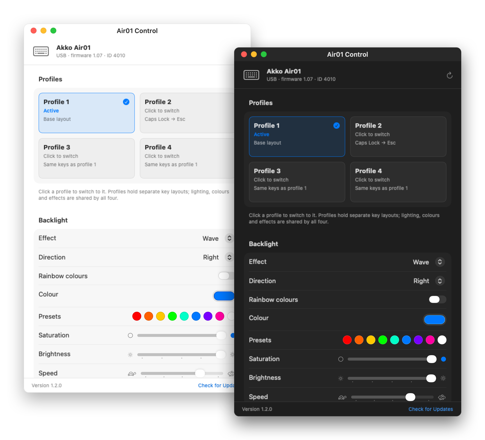

<div align="center">


# Air01 Control

**A small, native macOS settings app for the Akko Air01 keyboard.**

Change lighting, profiles and power settings from your Mac. No drivers, no account, nothing running in the background.

[](https://github.com/muunkk/air01-control/releases/latest) [](#requirements) [](#requirements) [](LICENSE)

[**Download**](https://github.com/muunkk/air01-control/releases/latest) · [Features](#features) · [Install](#install) · [FAQ](#faq) · [Build from source](#build-from-source)

<br>



</div>

## Features

- **Backlight.** 18 effects, from Static and Breathing to Ripple, Meteor and Snowfall. Set the colour (or rainbow), saturation, brightness, speed and, where the effect has one, direction.
- **Side light.** Effect, colour, saturation, brightness and speed for the edge light.
- **Profiles.** See all four profiles, switch with a click, and see how each one's key layout differs from profile 1.
- **Keyboard.** Debounce, plus sleep and deep-sleep timers for Bluetooth and 2.4 GHz.
- **Live and automatic.** Reads the current settings straight from the keyboard and saves changes about a second after you stop adjusting. There's no Save button.
- **Light and dark mode**, following your Mac's appearance.
- **Updates itself** from GitHub Releases.
- **Tiny and private.** Under 3 MB, written in SwiftUI and IOKit with no third-party code. The only network request is the update check to GitHub.

## Requirements

- macOS 14 Sonoma or later, on Apple Silicon or Intel.
- An Akko Air01, connected with a **USB-C cable**. Bluetooth and the 2.4 GHz dongle don't carry the settings channel.

| Air01 revision | Identify ID | USB ID | Support |
| --- | --- | --- | --- |
| Current revision | 4010 | `38ee:0005` | Full: read and change settings |
| Other revisions | 3013, 3452, 3658, 3818 | | Read-only |

Changes are only enabled for the revision the protocol has been confirmed on. If yours shows as read-only, [open an issue](https://github.com/muunkk/air01-control/issues) with the output of `--probe` (see [Diagnostics](#diagnostics)) to help add it.

## Install

1. Download `Air01-Control-<version>.zip` from the [latest release](https://github.com/muunkk/air01-control/releases/latest).
2. Unzip it and move **Air01 Control.app** to your Applications folder.
3. Open it. The app isn't notarized yet, so macOS blocks the first launch. Go to **System Settings → Privacy & Security** and click **Open Anyway**.
4. Allow it under **System Settings → Privacy & Security → Input Monitoring**. macOS requires this for any app that talks to a keyboard.

Updates install from inside the app: use the button in the footer, or **Air01 Control → Check for Updates…**. After an update, macOS may ask for Input Monitoring again. If the app can't reach the keyboard, remove it from that list and allow it again.

## Usage

- **Plug in the cable.** If the keyboard doesn't show up, slide its mode switch to wired.
- **Adjust anything.** Each change is written to the keyboard about a second after you stop.
- **Changed something with an Fn shortcut?** Click ↻, or switch back to the app, to re-read the keyboard.
- **Profiles** hold separate key layouts on the Air01, so each card says how its keys differ from profile 1. Lighting is shared by all four.

## Safety

Air01 Control is careful about what it sends to the keyboard:

- Changes are only enabled for the hardware revision confirmed to use this protocol (ID **4010**). Other revisions are read-only.
- The code contains no firmware, flash-erase, bootloader, factory-reset or keymap-write commands.
- After every save the app stays quiet for at least a second, because the keyboard commits each setting to flash and traffic during a commit can lock up its USB connection.

## FAQ

<details>
<summary><b>Why does it need a USB cable?</b></summary>

The Air01's settings channel only exists on the wired USB connection. Over Bluetooth or the 2.4 GHz dongle, the app can tell the keyboard is there but can't read or change its settings.
</details>

<details>
<summary><b>Why does macOS ask for Input Monitoring?</b></summary>

macOS requires that permission for any app that opens a keyboard's HID interface, even to change its lighting. Air01 Control only talks to the keyboard's settings channel and never reads what you type.
</details>

<details>
<summary><b>Why does macOS block the first launch?</b></summary>

Releases aren't notarized by Apple yet, so Gatekeeper asks you to confirm once. Use **Open Anyway** under System Settings → Privacy & Security. You can also [build it yourself](#build-from-source).
</details>

<details>
<summary><b>Can it remap keys?</b></summary>

Not yet. Key remapping, Fn-layer editing and full backup and restore are in progress in [#2](https://github.com/muunkk/air01-control/pull/2) and will ship once they've been tested on hardware.
</details>

<details>
<summary><b>Is this made by Akko?</b></summary>

No. It's an independent project, not affiliated with or endorsed by Akko. See the [disclaimer](#disclaimer).
</details>

## Build from source

You need the Xcode Command Line Tools (`xcode-select --install`). No Xcode project is required.

```sh
git clone https://github.com/muunkk/air01-control.git
cd air01-control
./build.sh           # builds "build/Air01 Control.app" (universal)
./build.sh install   # builds, then copies it to ~/Applications
```

### Diagnostics

Run these from the built binary, `"build/Air01 Control.app/Contents/MacOS/Air01Control"`:

| Flag | What it does |
| --- | --- |
| `--probe` | Lists matching HID devices and reads the settings (read-only). |
| `--keymaps` | Reads all four profiles' key layouts (read-only). |
| `--selftest` | Checks the packet encoder and decoder. |
| `--snapshot <dir>` | Renders the UI offscreen to PNGs, with sample data. |
| `--update-now` | Runs the updater without the UI. |

<details>
<summary><b>Releasing</b></summary>

1. Bump `VERSION` in a pull request and merge it.
2. On an up-to-date `main`, run `./release.sh "What changed"`. It builds, tests, zips and publishes the GitHub release, and the app's updater picks it up.

The app icon and README images are generated in code:

- `tools/make_icon.sh` regenerates `Resources/AppIcon.icns`.
- `tools/make_readme_images.sh` regenerates `docs/screenshot.png` and `docs/icon.png` from the app's own UI.
</details>

## Contributing

Bug reports and pull requests are welcome. The most useful contribution right now is `--probe` output from Air01 revisions other than 4010, so they can be supported safely.

## Credits

Protocol facts come from the open-source [sharkfin](https://github.com/dniminenn/sharkfin) project (GPL-3.0-or-later): its `docs/PROTOCOL.md`, its device registry, and the Air01's lighting-effect lists in `app/src-tauri/data/light-layouts.json`. No sharkfin code is included.

## Disclaimer

Air01 Control is an independent project. It is not affiliated with, endorsed by or supported by Akko. "Akko" and "Air01" are used only to say which keyboard it works with.

The app writes settings to the keyboard's flash memory using a protocol worked out by the community, not published by Akko. It is provided as is, without any warranty; you use it at your own risk. See sections 15 and 16 of the license.

## License

Copyright (C) 2026 Mel Boonchan. Licensed under [GPL-3.0-or-later](LICENSE). The license applies to every version in this repository's history, including earlier commits, branches, pull requests and releases. Material derived from other projects keeps its original copyright and notices.

This program is free software: you can redistribute it and/or modify it under the terms of the GNU General Public License as published by the Free Software Foundation, either version 3 of the License, or (at your option) any later version.
